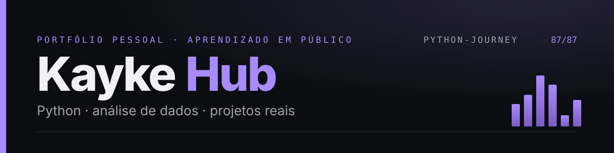
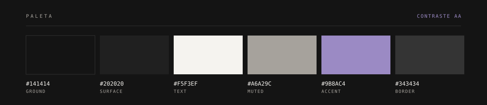

<p align="center">
  
</p>

<p align="center">
  <a href="https://kayke-dados.github.io/kayke-hub/"><strong>Site ao vivo</strong></a> ·
  <a href="https://github.com/kayke-dados/Python-Journey">Python-Journey</a> ·
  <a href="https://github.com/kayke-dados">GitHub</a> ·
  <a href="https://www.instagram.com/kayke.dados/">Instagram</a> ·
  <a href="mailto:kayke0812@proton.me">E-mail</a>
</p>


Cartão digital e portfólio de aprendizado de **Kayke — Python e Dados**. Página única, estática e bilíngue, com a direção `type-only-statement`: o nome em duas linhas e o tipo como imagem, ground grafite, ametista como único acento, contato em campo claro invertido e imagens desenhadas a partir dos dados reais.

## O que tem

- **Jornada real** — trilha com os capítulos do Python-Journey: 85 de 86 exercícios, capítulo 06 em 9/10 (`ex105` pendente), capítulo 07 reservado.
- **Projetos** — Python-Journey e Kayke Hub detalhados, com "Em desenvolvimento" separado com clareza.
- **GitHub ao vivo** — repositórios públicos via API, cache de 10 min e fallback para o perfil.
- **Imagens com origem** — faixa de 86 exercícios, mapa dos capítulos, capas dos projetos e QR desenhados em SVG; sem banco de imagens e sem mockup inventado.
- **Diário e agora** — marcos reais sem datas inventadas e o radar do que vem.
- **Contato** — e-mail como display, links, QR, copiar endereço e Web Share API.
- **PT/EN** — inglês aplicado no navegador por um dicionário `data-i18n`.
- **Acessibilidade** — contraste AA, foco visível, alvos de 44 px, `aria-current`, `prefers-reduced-motion` e menu funcional sem JavaScript.

<p align="center">
  
</p>

## Stack e estrutura

HTML5, CSS3 e JavaScript puro — sem framework, bundler ou backend. Fontes Manrope e IBM Plex Mono. Publicado no GitHub Pages.

```
index.html          página única (PT inline; EN via js/main.js)
css/style.css       design system + componentes
js/main.js          i18n, navegação, copiar/compartilhar
assets/             avatar, favicon, QR, og-image, art/ e capas dos projetos
tools/              geração de assets, arte SVG e do pacote de entrega
tests/              61 testes + 1 skip
reports/            auditoria, testes, publicação e histórico (v2–v6)
```

## Rodar e testar

```bash
python3 -m http.server 8000        # http://localhost:8000
python3 -m pytest tests/ -q        # 61 passed, 1 skipped
node --check js/main.js
```

## Design

<p align="center">
  
</p>

Texto 16,6:1 · secundário 7,25:1 · acento 5,99:1 · botão sólido 5,99:1. Zero gradientes, zero sombras; bordas finas, listas com hairline e ilustrações SVG feitas com a mesma paleta. O contato inverte para `#F5F3EF` com texto `#141414`; o QR usa `mix-blend-mode: multiply` para sumir com o fundo branco.

## Publicação

`git push` na `main` reconstrói o GitHub Pages (Settings → Pages → `main` / `/ (root)`). Se a URL mudar, atualize `SITE_URL` em `js/main.js` e rode `python3 tools/make_assets.py`.

## Notas honestas

- O **EN depende de JavaScript**; rastreadores e navegadores sem JS veem o PT.
- Os números são **atualizados manualmente** e conferidos pelos testes — sem promessa de tempo real.
- A API do GitHub é pública e sem token; se falhar ou limitar, o bloco mostra o link para o perfil.
- Sem Chrome e sem Pillow no ambiente: a verificação é por testes e lint, não por Lighthouse; o teste de dimensões de imagem fica skipado. Nenhum dado, projeto ou certificação é inventado.

---

Feito no ritmo de quem está aprendendo — consistência > intensidade.

[Kayke](https://github.com/kayke-dados) · [Python-Journey](https://github.com/kayke-dados/Python-Journey) · MIT
